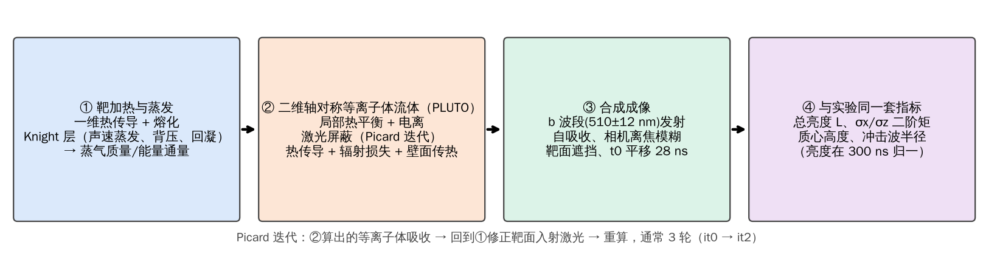
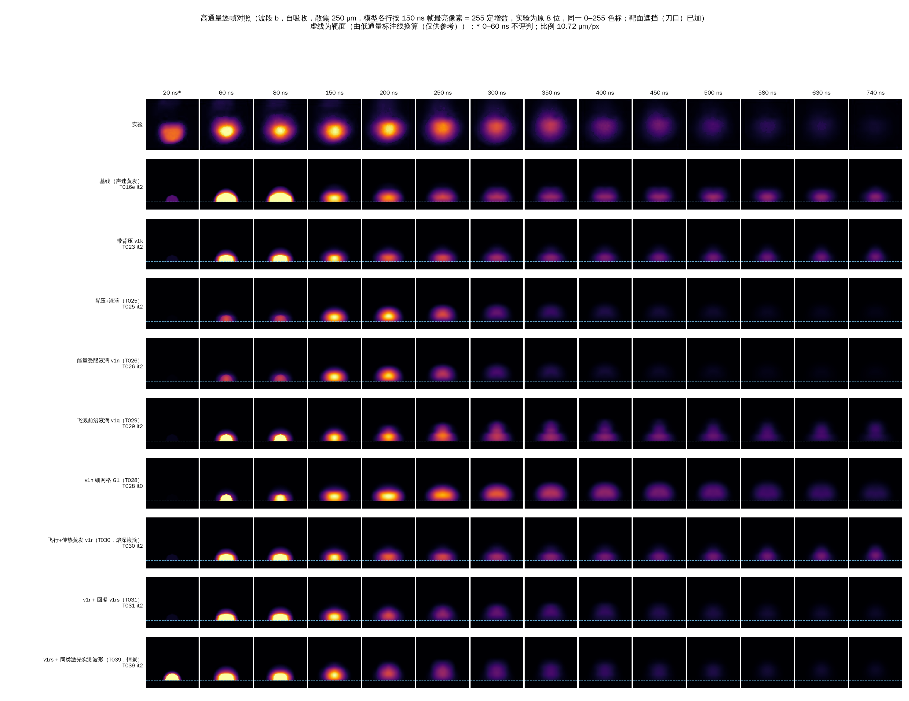
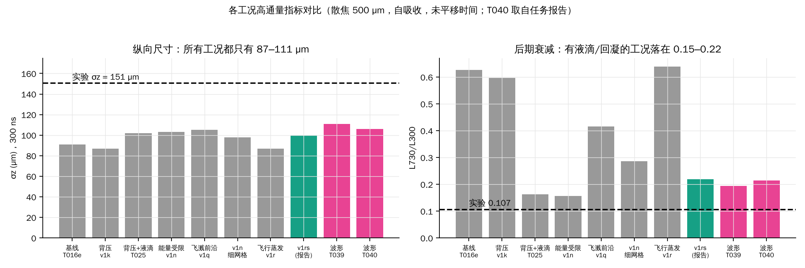
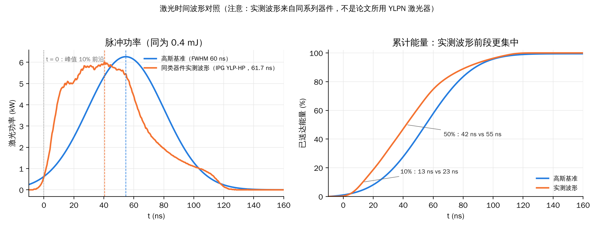
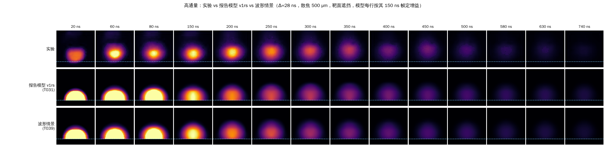
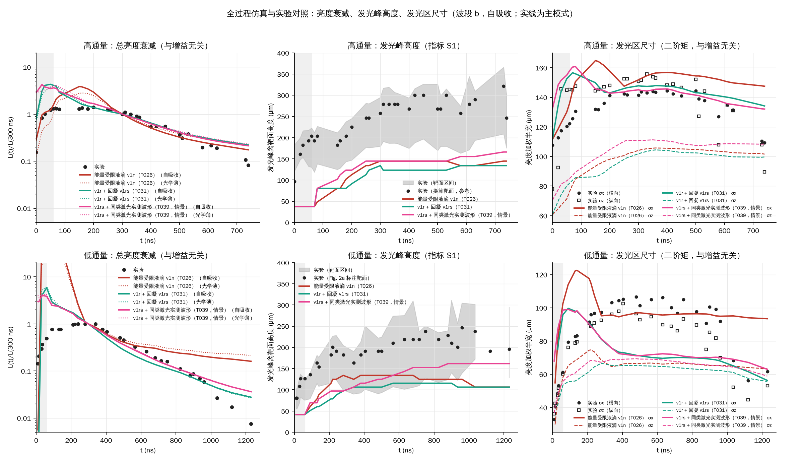
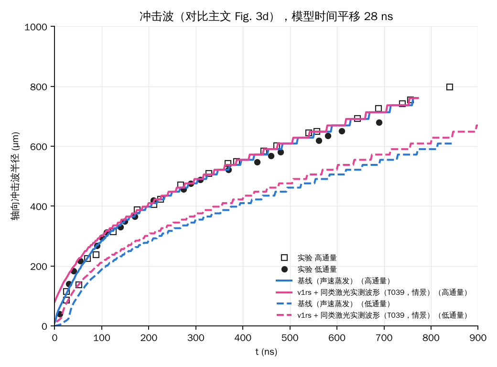
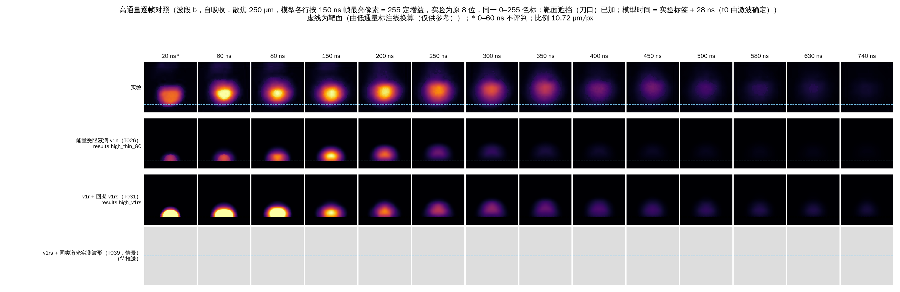
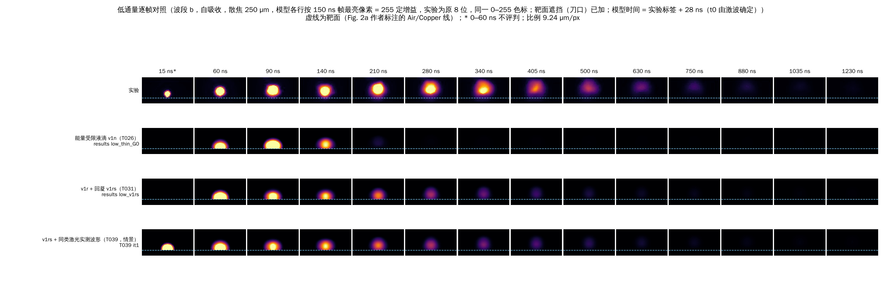

# 铜靶 ns 激光烧蚀等离子体羽流：仿真复现 Fig. S4 的进展汇报

*日期：2026-11-26 ｜ 目标文献：Chen et al., Laser Photonics Rev. 2025, 19, 2400388，补充材料 Fig. S4（高通量）与 S3（低通量）*

> **重要声明（请先读）：** 本报告里所有合成图像和指标，都是在发现"连续谱只计了 1–3 价离子"这一缺陷**之前**生成的（详见第五节 5.6）。代码已修正，工作站正在对全部高通量算例重新成像（任务 T044），**结果出来后图和数字会更新**。所以本报告中"发光偏暗、羽流偏短"的结论带有这一不确定性。

---

## 汇报要点（一页版，可直接对老师讲）

1. **做了什么：** 从靶面加热蒸发 → 二维流体 → 合成 b 波段图像，一条链用物理模型复现 Fig. S4（0.4 mJ）。所有新机制先预注册再出结果，没有为了贴合实验去调参数。
2. **老师的"羽流偏小"，主要是我们的相机离焦取小了。** 用实验最早几帧（0/20/30 ns，σx 只有 108–117 µm，由点扩散函数决定）反推离焦约 475–500 µm，恰好等于事先声明的"高"情景 500 µm。改用它后，横向尺寸对上了：模型 σx 145–149 µm，实验 141–145 µm。
3. **时间零点不在脉冲起点。** 用独立的泵浦–探测激波轨迹（主文 Fig. 3d，不是用羽流图像）拟合出偏移 Δ = 28 ns，平移后高通量激波 20–900 ns 与实验几乎重合。说明能量耦合总量没有大问题。
4. **亮度趋势：** 实验 L730/L300 = 0.107，当前报告模型 v1rs 为 0.22，在 2 倍以内。有物理依据的各项（反压、熔深液滴、回凝）依次加入后，才从 0.64 降到 0.22。波形情景 0.19–0.22。
5. **仍未解决：纵向尺寸偏短约 30%。** σz 模型 100–111 µm，实验 151 µm；纵横比 0.68（实验 1.07）；实验发光中心 0–30 ns 内从 101 µm 升到 197 µm，模型一直贴近靶面。
6. **这个缺口不是参数问题：** 8 组单参数敏感性（T034）σx 变化 ≤7%、纵横比变化 ≤11%；双温雪崩电离（T042）、把脉宽改读成 35 ns，都没有解决，也没被采用。激光能量 ≥99% 在靶面 3.5–6 µm 内被吸收。
7. **今晚发现一个成像缺陷：** 连续谱只算了 1–3 价离子，而热羽流（>90 kK）主要是 Cu⁴⁺/Cu⁵⁺，导致热的抬升部分被严重低估，很可能是"偏短"的一部分原因。已修代码，正在重新成像。接着还要补 Cu⁶⁺–Cu⁹⁺ 的电离能损耗（v1u），温度可能被高估。
8. **低通量仅作参考：** 所有模型点燃偏晚（40–55 ns，实验 10 ns 已发光），耦合能量少约 3 倍，目前所有尝试都补不上。

---

## 一、项目目标与实验数据

**目标。** 论文补充材料的 Fig. S4 给出高通量（0.4 mJ）下铜等离子体羽流的一系列时间分辨图像，Fig. S3 是低通量（0.32 mJ）。我们不是去拟合它们，而是从激光-靶-等离子体的物理出发，算出同样的图像，再与实验对比。导师的规则：**不为贴合结果而调参数；每个新机制先写入预注册文件（docs/PREREG_v0.md），再看第一个结果。** 目前焦点是高通量的亮度趋势和羽流尺寸；低通量只作参考。

**图像怎么拍的。** 带通滤波 b 波段（510 ± 12 nm），铜原子/离子谱线加连续谱，用相机拍摄各延时下的羽流。

**实验指标（模型用完全一样的算法算）：**

| 指标 | 含义 |
|---|---|
| L | 图像总亮度（像素值之和），看亮度随时间怎么衰减 |
| σx、σz | 亮度加权的二阶矩宽度（横向、纵向），衡量发光区尺寸，与相机增益无关 |
| 质心高度 zc、发光峰高度 | 发光中心离靶面多高 |
| 冲击波半径 | 来自主文 Fig. 3d 的泵浦–探测测量，独立于羽流图像 |

**高通量实验基准值（300 ns）：** σx = 141 µm，σz = 151 µm，纵横比 σz/σx = 1.07；L500/L300 = 0.37，L730/L300 = 0.107。

**一个重要限制：** 高通量实验图像在 50–160 ns 之间**饱和**（亮度到顶），这段时间的总亮度不可信。所以亮度趋势统一用 **300 ns 归一**（L(t)/L(300 ns)），不用 150 ns。

---

## 二、仿真流程总览

1. **靶加热与蒸发。** 一维热传导算靶面温度、熔化、蒸发；蒸发用 Knight 层模型，给出蒸气的质量和能量通量。
2. **二维轴对称等离子体流体（PLUTO）。** 局部热平衡（LTE）假设下的可压缩流体，包含电离、激光被等离子体"屏蔽"（吸收）、热传导、辐射损失。激光吸收与流场互相依赖，用 **Picard 迭代**解决：先假设一个激光到达靶面的强度，算流场，得到等离子体吸收，再回头修正靶面强度，重复几轮（it0 → it1 → it2）。
3. **合成成像。** 从流场的温度、密度出发，算 b 波段发射，考虑**自吸收**（羽流自己吸收自己的光），再模拟相机的**离焦模糊**（点扩散盘），并让靶体挡住靶面以下的光（**遮挡**）。
4. **同一套指标。** 合成图像用与实验相同的算法算 L、σx、σz 等，直接比较。

**两个对齐约定（都有依据，不是拟合图像得来）：**

- **t0 对齐 Δ = 28 ns**：实验时间零点不是脉冲起点（0 ns 帧已在发光，20 ns 时发光区半径已达 236 µm，而模型在约 25 ns 之前还没有吸收激光）。Δ 由独立的泵浦–探测激波轨迹拟合得到，v1n、v1rs 两个模型都拟合出 28 ns，且落在预注册的 ±30 ns 范围内。
- **相机离焦：** 高通量用 500 µm（见 5.1）。

**怎么读逐帧图。** 每行模型按自身 150 ns 那一帧的最亮像素定增益，所以同一行内可以比较亮度随时间的变化，**不同行之间主要比较形状和位置**。实验帧是原始 8 位图，早期帧在高亮处接近饱和。

---

## 三、各工况逐一讲解

每个工况都是在上一个基础上增加一项物理。下图是所有工况的逐帧图（高通量，**散焦 250 µm、未做时间平移**，是较早的版本，仅用于看各工况的形态差别；最新对比图见第四节）。

**小结表（高通量，300 ns；实验 σx 141、σz 151、纵横比 1.07、L730/L300 = 0.107）：**

| 行 | 工况 | σx | σz | L730/L300 |
|---|---|---|---|---|
| 2 | 基线 T016e | 156 | 91 | 0.63 |
| 3 | 背压 v1k（T023） | 149 | 87 | 0.60 |
| 4 | 背压+液滴 T025 | 149 | 102 | 0.16 |
| 5 | 能量受限液滴 v1n（T026） | 149 | 103 | 0.16 |
| 6 | 飞溅前沿液滴 v1q（T029） | 145 | 105 | 0.42 |
| 7 | v1n 细网格 G1（T028） | 159 | 98 | 0.29 |
| 8 | 飞行+传热蒸发 v1r（T030） | 149 | 87 | 0.64 |
| 9 | **v1rs（T031，报告模型）** | 147 | 100 | 0.22 |
| 10 | v1rs + 实测波形（T039，情景） | 145 | 111 | 0.19 |

（上表为散焦 500 µm、自吸收、未平移时间，由各算例的指标文件读出，单位 µm；T040 见 5.4。）

**读图要点：** 所有工况的 σz 都只有 87–111 µm，远低于实验的 151 µm，说明纵向偏短不取决于我们尝试过的这些蒸发/液滴方案。后期衰减则被"液滴+回凝"拉到接近实验。

### 行 1 实验（对照基准）
发光核心悬在靶面上方，随时间变圆、变暗，到 740 ns 几乎熄灭。

### 行 2 基线 T016e
- **做了什么：** 一维靶加热，声速（Knight 层）蒸发，二维 LTE 流体，激光屏蔽，热传导，辐射损失。
- **结果：** 衰减 L730/L300 = 0.64（实验 0.107），羽流贴着靶面且扁。
- **结论：** 只有蒸气时，能量散失太慢。

### 行 3 背压 v1k（T023）
- **做了什么：** 蒸发时考虑表面上方气体的反压（Knight 理论本身就有的项）。
- **结果：** 0.60，几乎同基线。
- **结论：** 蒸发速率不是主要矛盾。

### 行 4 背压 + 液滴（T025）
- **做了什么：** 按去除量的上限加入熔融铜液滴，在核心里强制蒸发。
- **结果：** 衰减很快（0.16）。
- **结论：** 能量不自洽：把气体冷到沸点以下仍在蒸发，不能采用。

### 行 5 能量受限液滴 v1n（T026）
- **做了什么：** 液滴只蒸发到混合气体仍高于沸点为止。
- **结果：** 衰减 0.16，纵横比 0.64。
- **结论：** 衰减对上，但要求液滴小于约 30 nm，没有依据（唯象模型），只作为一个"边界"保留。

### 行 6 飞溅前沿液滴 v1q（T029）
- **做了什么：** 液滴只在实测的飞溅顶端蒸发（实测飞溅速度 344 m/s）。
- **结果：** 衰减 0.42，纵横比 0.80。
- **结论：** 液滴蒸发位置的另一个极端，形貌好，衰减差。

### 行 7 v1n 细网格 G1（T028）
- **做了什么：** 网格加密，仅第一轮迭代。
- **结果：** 指标与粗网格相差 10–15%，网格收敛验证通过。
- **补充：** T028 在 150–400 ns 衰减和实验一样慢，看起来更像，但 500 ns 以后偏亮（740 ns 为 0.26，实验 0.06，约 4 倍）。这条曲线来自**第一轮迭代**（尚未计入自洽的激光屏蔽），与网格无关；迭代收敛后衰减变快。没有一个工况能再现实验"150–300 ns 保持明亮、之后快速熄灭"的形状。

### 行 8 飞行+传热蒸发 v1r（T030）
- **做了什么：** 液滴尺寸由熔深推出（约 4.5 µm），按飞行过程和真实传热计算蒸发。
- **结果：** 只蒸发约 0.4%，等同于没有液滴，0.64。
- **结论：** 物理尺寸的液滴蒸发不了。

### 行 9 v1rs（T031）：**报告模型**
- **做了什么：** 在 v1r 上，让铜蒸气按 Hertz–Knudsen 规律**回凝**到冷却的靶面，凝结系数取 1。
- **结果：** 衰减 0.22，纵横比 0.68，发光核心抬高。
- **稳健性：** 凝结系数降到 0.3，回凝量几乎不变（0.47 vs 0.48 ng）；表面温度上限取 0.85 时仍能点燃（v1n 熄灭）。
- **结论：** 第一个每一项都有物理依据的模型；两个通量下衰减都在实验 2 倍以内，所以定为报告模型。

### 行 10 波形情景 T039（情景，不是报告模型）
- **做了什么：** 激光脉冲改用 IPG YLP-HP 的实测波形（61.7 ns，能量更集中在前段），而不是 60 ns 高斯。
- **为什么只算情景：** 论文用的 YLPN 激光器已不存在，只能找到同系列另一型号的实测波形。
- **结果（T039，播种迭代）：** 纵横比 0.83，核心 153 µm，L730/L300 = 0.19；用激波重新拟合，所需时间偏移从 28 ns 降到 7 ns。
- **后续（T040，自洽迭代）：** 自己跑完 Picard 链后纵横比 0.72（σx 147、σz 106），L730/L300 = 0.215。所以 T039 的"形貌改善"大部分来自**播种**，不是波形本身。

*上图：高斯 60 ns 基准（蓝）与同类器件实测波形（橙），同为 0.4 mJ。实测波形前沿更陡，50% 能量在 42 ns 送达，高斯为 55 ns。*

### 低通量（仅参考）
- 所有模型点燃偏晚：模型约 40–55 ns，实验 10 ns 帧已经发光。
- 耦合进气体的能量少约 3 倍，激波偏小约 25%，羽流偏小，140 ns 后就变暗，而实验一直亮到 280 ns。
- 吸收率、所有登记参数、双温雪崩、实测波形都试过，补不上。

---

## 四、目前表现最好的工况与实验对比

"最好"这里不是靠对比挑出来的：**报告模型是 v1rs（因其每项都有物理依据而事先定为报告模型）**，波形是情景。下图把它们与实验并排放（高通量，Δ = 28 ns，散焦 500 µm，靶面遮挡，其它约定同前）：

**从图上看到的：**
- 约 200 ns 以后，两个模型的发光区大小、衰减节奏与实验大体相近。
- 早期（20–80 ns）模型的发光是紧贴靶面的亮"圆顶"，而实验的亮核明显悬在靶面上方。模型图在这几帧过曝（增益按 150 ns 帧设定），不要拿这几帧的亮度做定量比较。
- 实验发光区在纵向更长。

完整的曲线对比（亮度、发光峰高度、σx/σz，下图中粗红线为 v1n、绿为 v1rs、粉为波形情景）：

**从上排（高通量）图上看到的：**
- **亮度衰减：** 300 ns 之后三条模型曲线几乎重合，并与实验点衔接。到 700 ns 时模型仍明显高于实验（0.22 对 0.107）。0–150 ns 实验饱和，不评判。
- **发光峰高度：** 模型约 80–150 µm，实验约 200–300 µm，明显低。
- **尺寸：** σx 模型 145–149 µm 与实验点吻合；σz 模型虚线约 100–111 µm，实验空心点约 140–155 µm，偏低。

**冲击波（独立数据）：**

*上图：高通量（方框是实验）模型平移 28 ns 后，20–900 ns 与 Fig. 3d 吻合；低通量（圆点是实验）模型曲线明显偏小。*

**横向尺寸与"偏小"：** 把散焦从 250 µm 改为 500 µm 后，早期帧的 σx 与实验相符。历史图（250 µm）见附录。

---

## 五、今天（11-26）的关键进展

### 5.1 相机离焦校准：解释了"羽流偏小"
实验最早的高通量帧（0/20/30 ns）σx 只有 108/113/117 µm，此时源本身很小，宽度主要由点扩散函数决定，据此反推离焦 ≈ 475–500 µm，与事先声明的"高"情景（500 µm）一致。用它之后，300 ns 时 σx 模型 145–149 µm，实验 141–145 µm。此前的图用 250 µm，是"看起来偏小"的主要原因。低通量 10 ns 帧与 0 µm 一致。

### 5.2 遮挡检验
实验最早帧中，靶面以下只有 3–9% 的光，而"硬切"约定得 0%，"不切"得 35–40%，所以保留硬切约定。

### 5.3 敏感性（T034）：缺口不是参数问题
在 v1rs 上，对已登记参数逐个改动（共 8 组，高通量）：σx 变化 ≤ 7%，纵横比变化 ≤ 11%，σz 仍在 93–100 µm。

### 5.4 候选机制逐个检验
| 项目 | 做了什么 | 结果 | 结论 |
|---|---|---|---|
| T041 激光沉积诊断 | 看激光在哪里被吸收 | 所有算例 ≥99% 激光能量在靶面 3.5–6 µm 内被吸收 | 模型里没有沿光束向上爬升的吸收前沿 |
| T042 双温雪崩（非平衡电离） | v1rs 与波形上开启 | 沉积仍 <6 µm，σz 98–109 µm | 未达预注册的 20 µm 判据，**不采用** |
| T042 脉宽按 FWHM 35 ns | 脉宽读法改变 | 耦合能量 +45%（277 vs ~190 µJ），但 σz 仅 97 µm，激波拟合更差（log-RMSE 0.149 vs 0.085） | 不支持 |
| T040 波形自洽链 | 波形情景自己跑 Picard | 纵横比 0.72（σx 147、σz 106），L730/L300 = 0.215 | 播种的 T039（0.77）高估了波形的作用；波形仍只是情景 |
| T043 发光高度诊断 | 看羽流各区温度 | 脉冲期间和刚结束时，抬升的羽流为 50–135 kK；早期 b 波段发射主要来自靠壁的稠密层 | 解释了为什么模型的发光贴近靶面 |

### 5.5 已排除（估算）
- **液滴热辐射：** 液滴飞行高度低于发光中心，不是原因。
- **缺少壁面热传导：** 模型里已包含，带走约 35% 的吸收能量。

### 5.6 新发现的缺陷：连续谱只计了 1–3 价离子（修复待重新成像）
- **问题：** 合成图像的连续谱只统计了电荷 1–3 的离子，而热羽流主要是 Cu⁴⁺/Cu⁵⁺。连续谱正比于 z²，因此被低估：90 kK 时约 ×5，100 kK 时约 ×56，140 kK 低密度时可达 ×17000；60 kK 以下可以忽略。
- **影响：** 热的、抬升的羽流部分会被画得过暗，很可能是"羽流偏短/偏扁"的一部分原因。实验的发光质心在 0–30 ns 内从 101 µm 升到 153 µm 再到 197 µm，而模型贴近靶面，这与此缺陷方向一致（但**尚未验证**，不能说已解释）。
- **状态：** 代码已修（`src/lipsim/image/forward.py`、`src/lipsim/optics/props.py`），工作站正在对全部高通量算例重新成像（T044）。**本报告的图是修复前的。**
- **第二个同类缺陷（v1u，已声明、待做）：** 铜电离态只到 Cu⁵⁺，表格上限 150 kK，缺少 Cu⁶⁺–Cu⁹⁺（电离能 103–198 eV）的电离能量汇，温度可能被高估。需要新表并重算。

---

## 六、尚未解决的问题与下一步

| 问题 | 现状 | 下一步 |
|---|---|---|
| 高通量 σz 偏短约 30%（100–111 vs 151 µm），纵横比 0.68 vs 1.07 | 参数、雪崩、脉宽、波形都不能解决 | T044 重新成像，看修正连续谱后是否改变；再做 v1u |
| 发光中心贴近靶面（实验 0–30 ns 抬升到约 200 µm） | T043：早期发光由靠壁稠密层主导 | 同上，观察热羽流是否变亮 |
| 后期衰减偏慢（L730/L300 0.22 vs 0.107） | 在 2 倍以内 | 随 v1u 重算观察 |
| 低通量耦合能量不足约 3 倍，点燃偏晚 | 已试吸收率、参数、雪崩、波形，均无效 | 仅作参考，暂不投入 |
| 论文激光器（YLPN）的实测波形 | 器件已不存在，只有同类器件的波形 | 可再查文献；波形保持为情景 |

**要点：** 上述数字属于修复前的结果；T044 的新结果出来后要重新评估第三、四节的结论。

---

## 附录

### A. 名词解释

- **Picard 迭代：** 激光吸收和等离子体状态相互依赖，先猜一个、算流场、再据此更新激光入射，如此重复，直到变化很小。it0/it1/it2 是第 0/1/2 轮。
- **自吸收：** 羽流自己把一部分发射的光又吸收掉，所以中心部分的光出不来。
- **局部热平衡（LTE）：** 假设每个位置的电子、离子、激发态分布由同一个温度决定。
- **离焦盘（点扩散函数）：** 相机没有完全对准，一个点光源在图像上变成一个圆盘；本项目的"离焦 500 µm"就是这个盘的尺度。
- **刀口遮挡：** 靶体挡住从羽流射向靶面以下的光，所以图像中靶面以下是黑的。
- **t0 对齐（Δ = 28 ns）：** 实验时间零点与脉冲起点的差；用冲击波轨迹拟合得到。
- **预注册：** 在看到结果前，把要加入的机制、判据写入文件（docs/PREREG_v0.md），防止事后挑选。
- **报告模型 / 情景 / 敏感性：** 报告模型（v1rs）是正式结果；情景（波形、35 ns 脉宽）是替代输入；敏感性（单参数扰动、雪崩）是检验，不改变报告模型。
- **σx、σz：** 亮度加权的二阶矩宽度（标准差），不依赖相机增益。
- **L730/L300：** 730 ns 与 300 ns 的总亮度之比，衡量后期衰减；实验 0.107。
- **回凝（Hertz–Knudsen）：** 铜蒸气撞回已冷却的靶面时凝结，使靶面源在后期不再持续供蒸气。
- **kK：** 千开尔文。

### B. 图表清单（相对路径 figs/）

| 文件 | 内容 |
|---|---|
| flow.png | 仿真链示意（新） |
| focus_exp_v1rs_wave.png | 实验 vs v1rs vs 波形情景，Δ=28 ns，500 µm，遮挡（新，本报告生成） |
| bars_sigmaz_decay.png | 各工况 σz 与 L730/L300（新；T040 取自任务报告） |
| full_frames_high_occluded_g150_t28_d500.png | 高通量逐帧图，Δ=28 ns，500 µm（含 v1n、v1rs、波形三行模型） |
| full_frames_high_occluded_g150_t28.png | 同上，250 µm（历史） |
| full_frames_high_occluded_g150.png | 全部工况逐帧图，250 µm，未平移（历史） |
| full_frames_low_occluded_g150_t28.png | 低通量（仅参考） |
| full_curves_t28_dhigh.png | 亮度/高度/尺寸曲线，高通量 500 µm |
| full_shock_t28.png | 冲击波与 Fig. 3d |
| laser_waveform_compare.png | 高斯与实测波形 |

**历史图（散焦 250 µm，Δ = 28 ns，高通量）：**

**低通量（仅参考）：**

*图中低通量模型明显偏暗偏小，且 210 ns 之后 v1n 基本熄灭，与实验差距很大。*

### C. 数字来源
- 工况指标：由各算例 `metrics_b_sa_high.csv` 在 300 ns/730 ns 处读出（散焦 500 µm）。
- T034、T042、T043：`tasks/T034.report.md`、`tasks/T042.report.md`、`tasks/T043.report.md`。
- 各工况说明：`results/figures/cases_explained.md`、`results/figures/overnight_1126_summary.md`、`docs/DECISIONS.md`。
- 新图生成脚本：`results/report_1127/make_figs.py`、`make_flow.py`。
